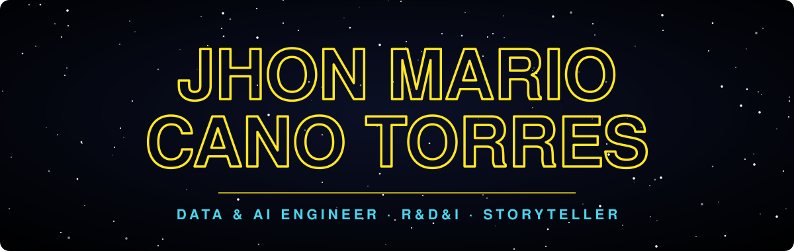
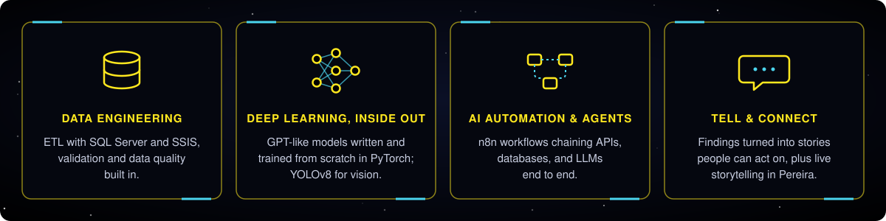

<p align="center">
  
</p>

<p align="center">
  
</p>

<p align="center">
  <a href="https://www.linkedin.com/in/jhon-mario-cano-torres-407b402b6"></a>
  <a href="mailto:Mariodscientist@gmail.com"></a>
  <a href="https://wa.me/573206039545"></a>
  <a href="https://www.instagram.com/purocuento_pereira"></a>
  
</p>

<p align="center">
  
</p>

<details>
<summary><sub>Read the crawl</sub></summary>

> **EPISODE I — THE DATA AWAKENS**
>
> It is a period of scattered data. Records drift across spreadsheets and legacy systems, and models are used by many but understood by few.
>
> In Pereira, Colombia, a Data & AI Engineer takes the slower path: build the pipeline by hand, open the model, and learn why it works.
>
> Because data only matters once it becomes a story someone can act on....

</details>


## 🛰️ `>> pilot profile`

**Data first. AI understood from the inside.**

My ground is data: getting it clean, reliable, and where it needs to be. On top of that I work with AI, and calling a model through an API has never been enough for me. I've studied LLMs down to how they actually work (tokenization, attention, training) and built a small GPT from scratch to prove it to myself.

I'm a Physics Engineer by training, so I trust what I can derive. I've also spent seven years as an oral storyteller, which keeps me honest about the last step: a result nobody understands hasn't been delivered yet.

```python
class JhonMario:
    def __init__(self):
        self.role       = "Data & AI Engineer · R&D&I"
        self.training   = "Physics Engineering ⚛️ · Universidad Tecnológica de Pereira"
        self.base       = "Pereira, Colombia 🇨🇴"
        self.ground     = ["ETL pipelines", "data quality", "SQL Server", "SSIS"]
        self.depth      = ["Transformers from scratch", "PyTorch", "computer vision"]
        self.side_quest = "oral storytelling every two weeks at Parque La Julia 🎙️"
        self.languages  = {"Spanish": "native", "English": "B2"}

    def creed(self):
        return "Open the model. Learn why it works. Then tell the story."
```


## 🧭 `>> flight log`

<p align="center">
  
</p>

<p align="center">
  
</p>


## ⚔️ `>> arsenal`

<p align="center"><b>Core systems</b></p>
<p align="center">
  
</p>

<p align="center"><b>Machine learning & deep learning</b></p>
<p align="center">
  
  <br>
  
  
  
</p>

<p align="center"><b>Data, AI & automation</b></p>
<p align="center">
  
  
  
  
  
  
</p>

<p align="center">🌱 <b>Padawan training in progress</b></p>
<p align="center">
   &nbsp;
  
</p>


## 📜 `>> holocron archives`

<table>
  <tr>
    <td width="50%" valign="top">
      <h3>🧠 Custom GPT-like Language Model</h3>
      <p>A compact GPT trained from scratch in <b>PyTorch</b> to understand Transformers at the tensor level: tokenization, self-attention, the training loop, sampling, and evaluation. Then I varied depth, embedding size, and context window to see what each one buys.</p>
      <a href="https://github.com/MariusDscientist/GPT_Sancho_mini_education"></a>
    </td>
    <td width="50%" valign="top">
      <h3>🖐️ Hands CAPTCHA</h3>
      <p>Prove you're human by drawing four digits in the air with your fingertip. <b>OpenCV</b> and <b>MediaPipe</b> track the hand, the strokes become images, and a neural network reads them back.</p>
      <a href="https://github.com/MariusDscientist/hands_captcha"></a>
    </td>
  </tr>
  <tr>
    <td width="50%" valign="top">
      <h3>🎯 YOLOv8 Object Detection</h3>
      <p>A four-class detector trained on 243 images. Class imbalance handled with data augmentation and curriculum learning; learning rate, batch size, and augmentation tuned against mAP and recall.</p>
    </td>
    <td width="50%" valign="top">
      <h3>🗄️ End-to-End ETL Pipeline</h3>
      <p>Extraction, transformation, validation, and loading with <b>SQL Server</b> and <b>SSIS</b>, with data quality checks, standardization, and logging for analytical datasets.</p>
    </td>
  </tr>
</table>


## 📡 `>> ship telemetry`

<p align="center">
  
</p>

<p align="center">
  <picture>
    <source media="(prefers-color-scheme: dark)" srcset="https://raw.githubusercontent.com/MariusDscientist/MariusDscientist/output/snake-dark.svg">
    
  </picture>
</p>

<p align="center">
  
</p>
